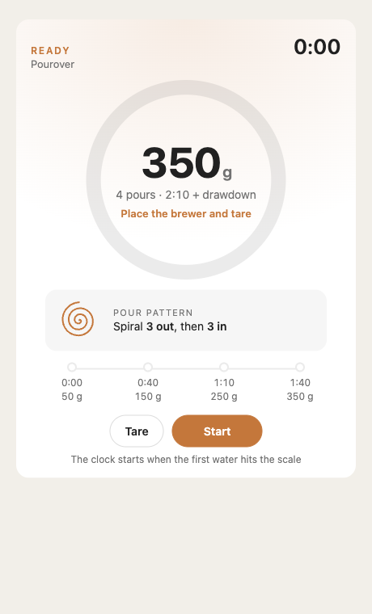
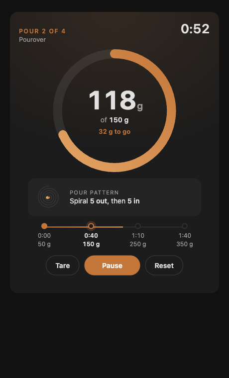
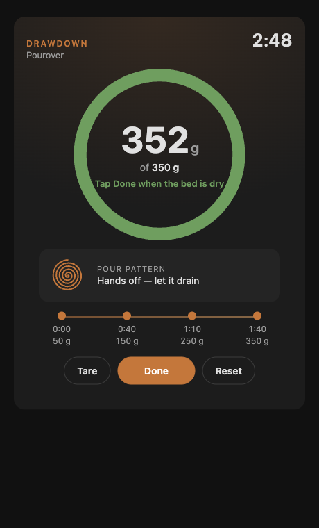

# Pourover Card

A Home Assistant dashboard card that walks you through a pourover brew, one pour at a time. The default recipe is Blue Bottle's four-pour method. Optionally, the card reads live weight from a scale such as an Acaia.

| Ready | Pour 2, with scale | Drawdown |
|---|---|---|
|  |  |  |

## What it does

- **Ring dial.** With a scale, it fills toward the current pour's target weight. Without one, it fills toward the next pour's start time.
- **Spiral guide.** An animated spiral shows the pour pattern (for example, 5 laps out, then 5 in).
- **Timeline.** Shows all four pours, with the current one highlighted.
- **Cues.** A soft chime plays and the ring pulses when the next pour is due. The ring turns green when you hit a target.
- **Auto-start.** With a scale, tap **Start** to arm the card. The clock starts when the first water lands on the scale (more than 2 g).

### Default recipe

| Pour | Start | Finish weight | Laps |
|---|---|---|---|
| 1 | 0:00 | 50 g | 3 out, 3 in |
| 2 | 0:40 | 150 g | 5 out, 5 in |
| 3 | 1:10 | 250 g | 5 out, 5 in |
| 4 | 1:40 | 350 g | 5 out, 5 in |

## Install (HACS)

1. HACS → ⋮ → **Custom repositories**.
2. Add this repo's URL, with category **Dashboard**.
3. Find **Pourover Card** and click **Download**. HACS registers the resource for you.
4. Reload the browser.

## Configure

The minimal config, guided by time only:

```yaml
type: custom:pourover-card
```

With an Acaia scale, using the core [Acaia integration](https://www.home-assistant.io/integrations/acaia/):

```yaml
type: custom:pourover-card
weight_entity: sensor.lunar_weight
tare_entity: button.lunar_tare
```

| Option | Default | Notes |
|---|---|---|
| `title` | `Pourover` | Subtitle under the phase label |
| `weight_entity` | none | Sensor reporting grams. If it is missing or unavailable, the card falls back to time-only guidance |
| `tare_entity` | none | Button entity; shows a **Tare** button |
| `start_threshold` | `2` | Grams that trigger auto-start when armed |
| `tolerance` | `1` | Grams under target that still count as reaching it |
| `chime` | `true` | Plays a sound on pour cues |
| `drawdown_at` | last start + last interval | Time-only mode: when the last pour ends (2:10 by default) |
| `pours` | Blue Bottle | List of `{ start, target, laps_out, laps_in }`. `start` is in seconds, `target` in grams |

### How the phases work with a scale

- When you reach a target, the card shows a **wait** countdown until the next pour's start time.
- If you are behind schedule, the next pour starts as soon as the previous target is reached.
- After the final target, the card shows **Drawdown**. Tap **Done** to stop the clock.

## Develop

- `npm test` runs the logic tests (Node 20+, no dependencies).
- `python3 -m http.server` serves the dev harness at `/dev/index.html`. Query params: `scale=1`, `weight=118`, `t=52`, `status=running|paused|armed|done`, `theme=dark`, `shots=1` (freezes the clock).
