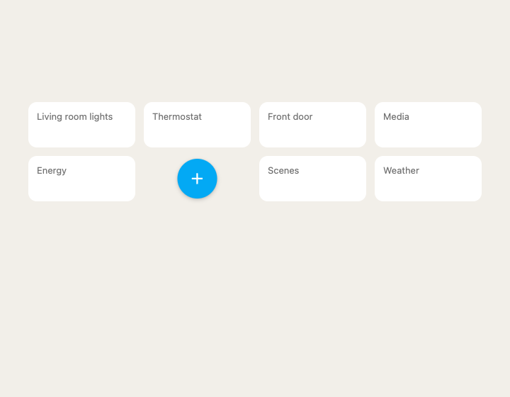
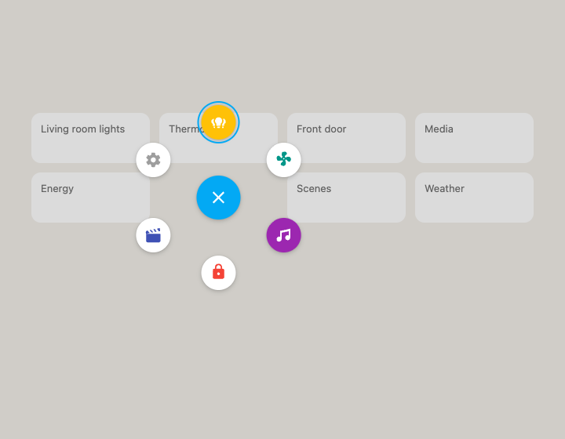
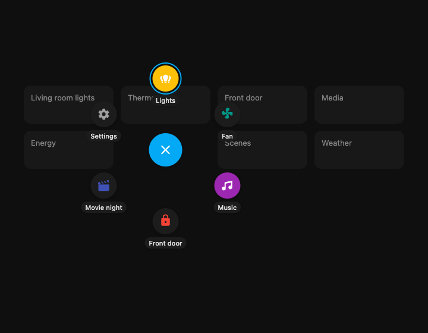
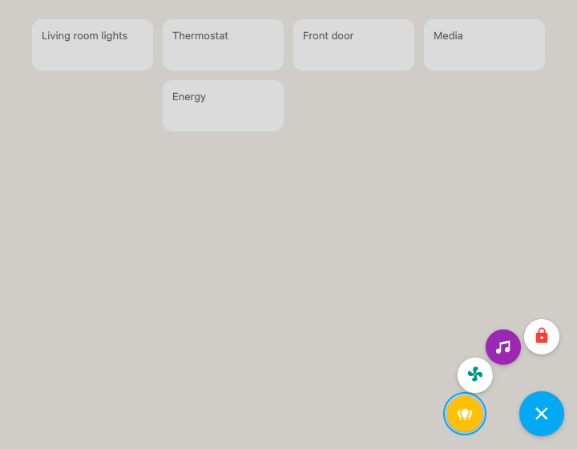
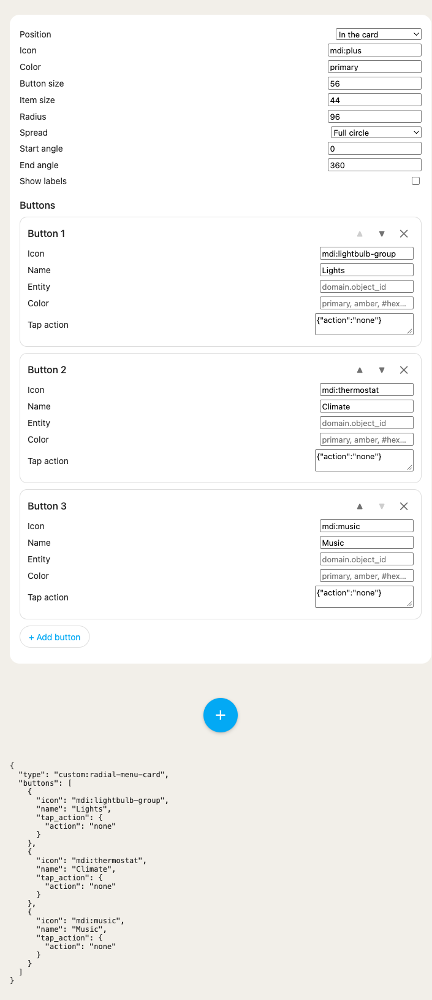

# Radial Menu Card

A round button that is always on screen. Tap it and a ring of action buttons fans out around it, one per configured action. Tap an action to run it and the ring closes. Tap the centre button, tap anywhere else, or press Escape to close it without doing anything.

| Closed | Open | Labels, dark theme |
|---|---|---|
|  |  |  |

## What it does

- **Two placements.** `position: inline` (default) puts the button in the card's grid slot. `position: fixed` floats it at a screen corner, like a mobile action button, and the card takes almost no grid space.
- **Overlay ring.** When open, the ring is drawn in a full-screen layer over the dashboard, so neighbouring cards never clip it. The faint backdrop is the tap-to-dismiss area.
- **Any spread.** A full circle by default. `start_angle` and `end_angle` make half or quarter arcs for buttons near an edge. Floating buttons default to the quarter arc that points into the screen.
- **No overlap.** `radius` is a minimum. With many buttons on a narrow arc, the card grows the radius so items never touch.
- **Standard actions.** Each button carries a normal Home Assistant `tap_action`, so `toggle`, `more-info`, `navigate`, `url`, `perform-action`, `assist`, and confirmations all work exactly as they do on built-in cards.
- **Entity state.** A button with an `entity` is filled with its colour while that entity is on, open, playing, home, or unlocked. Without an `icon`, it uses the entity's icon.
- **Labels.** `show_labels: true` adds a small name under each button.



## Configure

The card has a visual editor: **Add card → Radial Menu Card**. The top form sets the centre button and the spread; each action button has its own form with an icon picker, entity picker, colour, and the standard action editor. Use ▲ ▼ to reorder and ✕ to remove.



*Screenshot from the dev harness, which uses stand-ins for HA's form fields. In HA, the icon, entity, colour, and action fields are the real pickers.*

In YAML:

```yaml
type: custom:radial-menu-card
buttons:
  - name: Lights
    entity: light.kitchen
    icon: mdi:lightbulb-group
    color: amber
    tap_action:
      action: toggle
  - name: Movie night
    icon: mdi:movie-open
    color: indigo
    tap_action:
      action: perform-action
      perform_action: scene.turn_on
      target:
        entity_id: scene.movie
  - name: Settings
    icon: mdi:cog
    tap_action:
      action: navigate
      navigation_path: /config
```

Floating at the bottom-right corner:

```yaml
type: custom:radial-menu-card
position: fixed
corner: bottom-right
buttons:
  - entity: light.kitchen
    tap_action:
      action: toggle
  - entity: lock.front_door
```

| Option | Default | Notes |
|---|---|---|
| `position` | `inline` | `inline` sits in the grid; `fixed` floats at a screen corner |
| `corner` | `bottom-right` | `fixed` only: `bottom-right`, `bottom-left`, `top-right`, `top-left` |
| `icon` | `mdi:plus` | Centre button icon. It shows a close icon while open |
| `color` | `primary` | A theme colour name (`primary`, `accent`, `red`, `amber`, `teal`, …) or any CSS colour |
| `size` | `56` | Centre button diameter in px |
| `item_size` | `44` | Action button diameter in px |
| `radius` | `96` | Centre-to-item distance in px, grown if items would overlap |
| `start_angle` | `0` (inline) | Degrees. `0` is up, clockwise. Floating buttons default to the quarter arc that points into the screen |
| `end_angle` | `360` (inline) | A span of 360 is a full circle; anything less is an arc that includes both endpoints |
| `show_labels` | `false` | Shows each button's `name` under it. Raise `radius` to make room |
| `buttons` | required | List of buttons, see below |

Each entry in `buttons`:

| Key | Notes |
|---|---|
| `icon` | An `mdi:` icon. Optional when `entity` is set |
| `name` | Tooltip, screen-reader label, and the label text when `show_labels` is on |
| `entity` | Optional. Default icon, default action (`more-info`), and active styling |
| `color` | Theme colour name or CSS colour. Defaults to the card's `color` |
| `tap_action` | Any Home Assistant [action](https://www.home-assistant.io/dashboards/actions/). Defaults to `more-info` with an entity, `none` without |

Theme hooks: `--rm-scrim` (backdrop colour) and `--rm-surface` (inactive item background) can be set on the card via `card-mod` or a theme.

## Develop

The harness is `dev/radial-menu-card.html`. Query params: `theme=dark`, `position=fixed`, `corner=bottom-left`, `open=1`, `labels=1`, `n=4` (how many of the sample buttons), `spread=top` (any preset name), `radius=120`, `shots=1` (hides the log, leaves room for the ring). Tapping a button logs the `hass-action` event it fired, and toggles flip the mock entity so active styling can be seen.

The editor harness is `dev/radial-menu-card-editor.html`. It shows the editor next to a live preview and the emitted config.
